

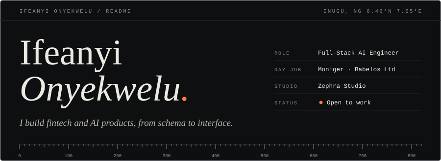

 

[xife3.space](https://xife3.space) &nbsp;·&nbsp; [Zephra Studio](https://zephra.dev) &nbsp;·&nbsp; [X](https://x.com/ifeanyicodes_) &nbsp;·&nbsp; [LinkedIn](https://www.linkedin.com/in/ifeanyichukwu-onyekwelu-36b93922b) &nbsp;·&nbsp; [Email](mailto:ifeanyionyekwelu786@gmail.com)

## About

I'm a full-stack engineer with 5+ years of experience building web, mobile and backend systems, from fintech to multi-tenant SaaS. By day I work on [Moniger](https://moniger.com) at Babelos Ltd. I also run [Zephra Studio](https://zephra.dev), a software studio in Enugu, Nigeria that builds production-ready products for founders and businesses.

My current focus is applied AI: retrieval pipelines, vector embeddings, tool-calling agents and the infrastructure that keeps them reliable. I'm studying Computer Science at Godfrey Okoye University alongside.

## Selected work

<table>
  <tr>
    <td width="50%"><a href="https://boxieai.zephra.dev">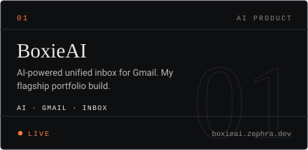</a></td>
    <td width="50%"><a href="https://zephra.dev">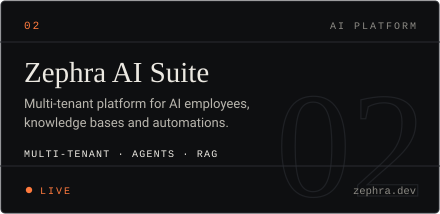</a></td>
  </tr>
  <tr>
    <td width="50%">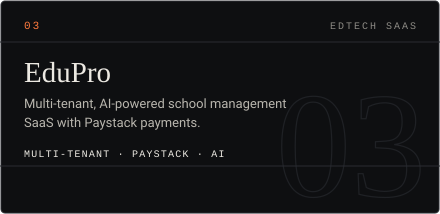</td>
    <td width="50%"><a href="https://gbam.app">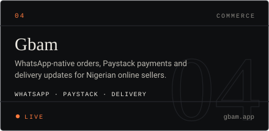</a></td>
  </tr>
  <tr>
    <td width="50%"><a href="https://moniger.com">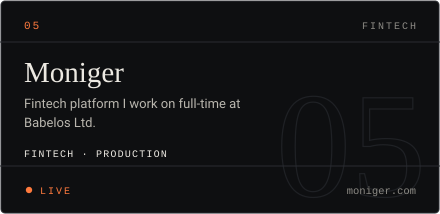</a></td>
    <td width="50%"><a href="https://ziippa.app">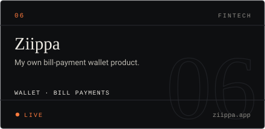</a></td>
  </tr>
  <tr>
    <td width="50%"><a href="https://github.com/zephradev/payzeph">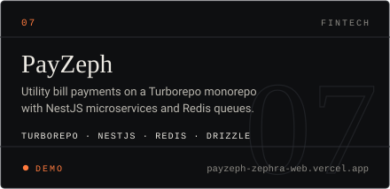</a></td>
    <td width="50%"><a href="https://github.com/zephradev/flowanalytics">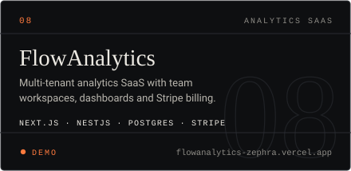</a></td>
  </tr>
</table>

Also built: [Savvio](https://savvio-budgetting.vercel.app) (budget and expense tracker) · [MediBook](https://medibook-zephra.vercel.app) (appointment booking).

## Stack

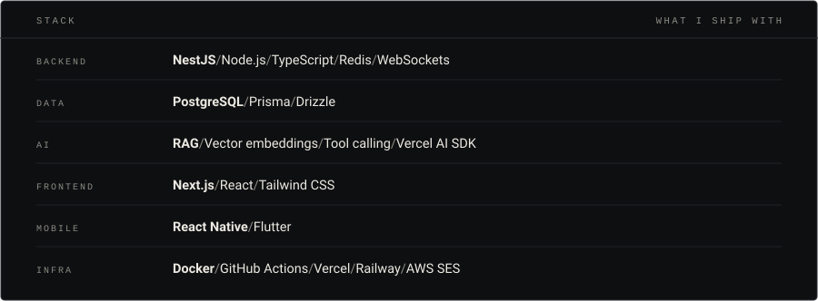

## Activity


## How I build AI features

The pattern I reach for when shipping retrieval-backed AI inside a multi-tenant product:

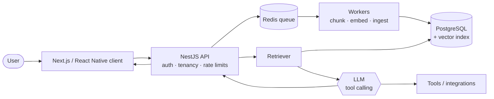

Tenant isolation at the data layer, async ingestion so requests stay fast, typed tool contracts, and observability around every model call.

## Zephra Studio

A software studio building web apps, mobile apps, backends, SaaS products and AI integrations for founders who want to ship. Start a project at [hello@zephra.dev](mailto:hello@zephra.dev) or [zephra.dev](https://zephra.dev).

## Now

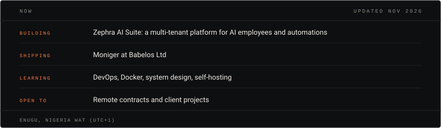
